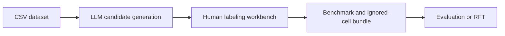

# Data Quality LLM

A research workbench for finding data-quality problems in CSV files, reviewing
those findings with humans, and exporting a cell-level benchmark.

The system uses Azure-hosted language models to generate high-recall candidates.
The human labels, corrections, exclusions, and missed-error annotations are the
source of truth.



## What you can do

- Scan one CSV or a directory of CSVs for nine classes of data-quality errors.
- Run a single pass or repeated adaptive passes with Good-Turing/Chao1 coverage
  estimates.
- Review candidates in their source-table context.
- Correct model proposals and add false negatives the model missed.
- Standardize inconsistent column values with a dedicated column board.
- Exclude out-of-scope files, rows, or columns without calling them clean.
- Export an evaluation bundle with benchmark labels, ignored-cell immunity, and
  the scoring contract.

## Fastest path: label a dataset

### 1. Install

Requirements: Linux or macOS, Python 3.10+, Azure CLI, and access to Azure
OpenAI deployments.

```bash
./create_venv.sh
source venv/bin/activate
pip install -r requirements.txt -r requirements-dev.txt
az login
cp .env.example .env
# Edit .env, then load it for direct CLI commands:
set -a; source .env; set +a
```

Edit `.env` and set at least `AZURE_OPENAI_ENDPOINTS`. Authentication uses
`AzureCliCredential`; do not put API keys in the repository. The workbench
loads `.env` automatically, but direct Python commands read the current process
environment and therefore need the `source` step above.

### 2. Add CSV files

Data is not bundled with the repository. Put a CSV or dataset directory under
`data/`:

```text
data/
  my_dataset/
    customers.csv
    orders.csv
```

`data/` is ignored by Git. Keep source filenames and row order stable once
labeling begins because benchmark cells use `(source, row, column)` identities.

### 3. Start the workbench

```bash
./scripts/run_server.sh start --port 8000 --annotator your-name
```

Open `http://localhost:8000/`. In the UI:

1. Open **Launch new run**.
2. For the first live run, choose one small CSV rather than a full directory.
3. Select only `typo`, set **Max chunks** to `1`, and enable **Skip Phase-B
  synthesis**.
4. For a first smoke run, choose **single** mode; adaptive mode can run several
  LLM passes per detection arm.
5. Preview the generated command, then launch the run.
6. When the run completes, select **Label**.
7. Review candidates, add missed errors, and export **Eval bundle
   (recommended)**.

The complete annotation workflow, verdict definitions, false-negative review,
inconsistency column board, exclusions, quality checks, and export format are in
[the labeling guide](LABELING_GUIDE.md).

Server operations:

```bash
./scripts/run_server.sh status
./scripts/run_server.sh restart --port 8000 --annotator your-name
./scripts/run_server.sh stop
```

## Run detection from the command line

Render the first prompt without making an LLM call:

```bash
python -m experiments.run_cleaning_detection \
  --csv data/my_dataset/customers.csv \
  --error-types typo \
  --mode single \
  --no-synthesis \
  --dry-run
```

Run a focused single-pass scan:

```bash
python -m experiments.run_cleaning_detection \
  --csv data/my_dataset/customers.csv \
  --error-types typo,semantic_incompatible,numeric_outlier \
  --mode single
```

Run a whole dataset directory:

```bash
python -m experiments.run_cleaning_detection \
  --csv-dir data/my_dataset \
  --csv-glob '*.csv' \
  --mode single
```

List the taxonomy without data or Azure calls:

```bash
python -m experiments.run_cleaning_detection --list-error-types
```

Most operational settings have CLI overrides. Use `--help` for the actual CLI
surface and edit `config/experiment.yaml` for settings not exposed there.

## Supported error types

The taxonomy lives in [`prompts/error_types.yaml`](prompts/error_types.yaml).

| Scope | Error types |
|---|---|
| Single column | `typo`, `inconsistency`, `semantic_incompatible`, `numeric_outlier` |
| Multiple columns | `fd_violation`, `row_calculation_inconsistency`, `string_calculation_inconsistency` |
| Multiple rows | `row_duplication` |
| Multiple tables | `inter_table_inconsistency` |

Multi-column, multi-row, and multi-table checks need broader table context and
may use dedicated relation, duplication, or cross-table pipelines rather than
the generic chunk detector.

## Labeling decisions and export

The workbench records append-only decisions under each run directory:

| Human decision | Benchmark meaning |
|---|---|
| `tp` or `partial` | error |
| `fp` | clean |
| `unsure` | ambiguous |
| `skip` | omitted and made FP/FN-immune |
| cell `fn` | missed error added by the reviewer |

The recommended eval bundle contains:

- `benchmark.jsonl`: one authoritative record per `(source, row, column)`;
  row-level findings such as duplication use `column=""` as a sentinel;
- `benchmark.ignored.jsonl`: skipped and excluded cell/row/column/CSV scopes;
- `MANIFEST.txt`: the cell-level micro-F1 scoring contract.

Labels persist after every save. Reopening a run continues from its append-only
JSONL stores.

## Outputs

Each run is written under `outputs/<run_id>/`. Common artifacts include:

| Artifact | Purpose |
|---|---|
| `report.html` | self-contained interactive report |
| `summary.json` | run-level metrics and configuration |
| `clusters.jsonl` | review candidates after clustering |
| `issues.jsonl` | raw per-type detections |
| `raw_responses/` | model responses for audit/debugging |
| `labels.jsonl` | append-only human verdicts |
| `benchmark.jsonl` | materialized benchmark after export |
| `good_turing/` | adaptive coverage estimates, when enabled |

`outputs/` is ignored by Git. Back up important run directories or download the
eval bundle before deleting a workspace.

## Repository map

```text
config/experiment.yaml   runtime configuration
prompts/                 taxonomy and LLM prompt templates
experiments/             CLI entry points and orchestration
src/core/                detection, clustering, relation, and report logic
src/adaptive/            repeated-pass coverage estimation
src/labeling/            FastAPI workbench and append-only stores
frontend/labeling/       labeling UI
external/baseline/       maintained comparison baselines
RFT/                     experimental reinforcement fine-tuning engine
scripts/run_server.sh    detached workbench server
```

The code, prompt language, and runtime settings are separated intentionally.
Change the taxonomy in YAML rather than embedding policy in Python.

## Maintained external baseline

The tracked baseline package lives under `external/baseline/`:

```bash
python -m external.baseline.prompt
python -m external.baseline.label_gpt55 --help
python -m external.baseline.inconsistency.optimize --help
```

See [`external/baseline/README.md`](external/baseline/README.md) for its setup and
scoring workflow. Other content under `external/` is local experimental scratch
and remains ignored.

## Testing

Run focused tests while developing, then the non-live suite:

```bash
python -m pytest -q tests/test_export_benchmark.py
python -m pytest -q -m 'not integration'
```

Live-service tests are opt-in and may spend Azure tokens. The repository also
contains historical lint debt, so use Ruff on touched files instead of treating
a full-tree lint run as a clean baseline:

```bash
python -m ruff check --select F,I path/to/touched.py tests/test_touched.py
```

## Data, privacy, and repository scope

Representative local paths are intentionally ignored:

```text
data/ outputs/ benchmark/ label_result/ logs/ backups/ docs/ notebooks/
```

See [`.gitignore`](.gitignore) for the authoritative list, which also covers
additional generated formats, caches, state directories, and external scratch.

Do not commit source datasets, human benchmark rows, raw model responses, cloud
job state, `.env`, credentials, organization-specific endpoints, or assistant
IDs.

## Experimental RFT status

`RFT/` is being flattened from historical versioned packages to one current
package per task. **RFT is currently unavailable** because stale versioned
imports remain. Candidate generation and the labeling workbench are the primary
supported workflows. The refactor is complete only when both commands pass:

```bash
python -m RFT.cli --list-tasks
python -m pytest -q RFT/tests/test_rft_cli.py -k 'not prepare_validates_real_splits'
```

Treat a failing import as a refactor blocker; do not restore dependencies on old
`vN` packages. Coding agents should read [`AGENTS.md`](AGENTS.md) before touching
RFT or shared pipeline code.

## Documentation

- [`LABELING_GUIDE.md`](LABELING_GUIDE.md): complete human labeling workflow.
- [`AGENTS.md`](AGENTS.md): architecture, invariants, and validation guidance for
  coding agents.
- [`external/baseline/README.md`](external/baseline/README.md): maintained
  baseline methods.
